# Documentación de entrega — microservicios
## Sistema de Pedidos de Restaurante

**Estado:** un solo documento de entrega académica tras el corte a microservicios.  
**Producto:** RF1–RF5.  
**Diseño interno:** Hexagonal dentro de cada servicio (`../documentacion-inicial/arquitectura-hexagonal.md`).  
**Corte:** fases 1–5 cerradas (`../microservicios/analisis.md`).  
**Smoke:** 4 nov 2026 — menú → mesa → orden → cocina → cobro gRPC → `CLOSED` (**SMOKE_OK**).

---

# Índice

1. [Propuesta y alcance](#1-propuesta-y-alcance)
2. [Arquitectura implementada](#2-arquitectura-implementada)
3. [Casos de uso](#3-casos-de-uso)
4. [Flujos de negocio](#4-flujos-de-negocio)
5. [Diagramas de secuencia](#5-diagramas-de-secuencia)
6. [Modelo entidad–relación](#6-modelo-entidadrelación)
7. [Navegación UI](#7-navegación-ui)
8. [Guía de extensión](#8-guía-de-extensión)
9. [Verificación](#9-verificación)

---

# 1. Propuesta y alcance

## 1.1 Qué se entrega

Un sistema de pedidos para restaurante que cumple RF1–RF5, con:

1. Hexágono (puertos y adaptadores) **dentro de cada servicio**.
2. Microservicios por contexto de negocio.
3. Gateway REST como única puerta pública hacia Menú, Salón y Órdenes.
4. Pagos interno (solo gRPC), invocado por Órdenes.
5. Web Next.js como adaptador de entrada del personal del local.

### Problema de negocio

Los restaurantes reciben pedidos por varios canales y las herramientas externas cambian. Las reglas de venta (precios capturados, cocina, totales, cobro) no deben quedar atadas a un solo proceso ni a una sola base.

### Qué cambió respecto a Gen 1

| Nivel | Gen 1 | Esta entrega |
|-------|-------|--------------|
| Diseño interno | Hexagonal | Igual, **repetido por servicio** |
| Estilo | Monolito modular | Microservicios |
| Despliegue | Un proceso API + una BD | Varios procesos + **una BD por servicio** + gateway |
| Cobro | Adaptadores fake en proceso | Proceso `payments` detrás de `PaymentPort` vía gRPC |

## 1.2 Requisitos funcionales

| ID | Requisito | Dónde vive |
|----|-----------|------------|
| **RF1** | Administrar menú | Servicio **Menú** |
| **RF2** | Abrir comanda (mesa o ID externo) | **Órdenes** (+ **Salón** si es mesa) |
| **RF3** | Líneas según cocina; no editable al iniciar cocción | Agregado `Order` en **Órdenes** |
| **RF4** | Totales deterministas | Dominio de **Órdenes** |
| **RF5** | Cerrar y cobrar | **Órdenes** orquesta; **Pagos** ejecuta |

## 1.3 Decisiones cerradas

| Nivel | Decisión |
|-------|----------|
| Diseño interno | Hexagonal; núcleo estilo Clean |
| Estilo | Cuatro servicios + gateway + web |
| Público | REST + JSON (navegador → gateway) |
| Interno | gRPC + Protobuf (`packages/contracts`) |
| Persistencia | PostgreSQL, base por servicio |
| Cobros MVP | Simulados detrás de `PaymentPort` |
| Eventos | Outbox `OrderSentToKitchen` (aviso; no cobra ni calcula) |

Fuera de alcance sin acuerdo: pasarelas reales, auth avanzada, app móvil, GraphQL/tRPC, event-bus como base del cobro.

## 1.4 Visión

```text
                    Personal del local
                            │
                            ▼
                   ┌─────────────────┐
                   │  Next.js (web)  │
                   └────────┬────────┘
                            │ REST / JSON
                            ▼
                   ┌─────────────────┐
                   │    Gateway      │  enruta; no calcula ni cobra
                   │   :3000 REST    │
                   └───┬─────┬───┬───┘
           /menu-items │     │   │ /orders (+ cuenta de mesa)
                       │     │   │ /tables/:id/account → Órdenes
                       ▼     ▼   ▼
                   Menú   Salón  Órdenes (apps/api)
                  :3002   :3003  :3001 REST
                  :50052  :50053 :50054 gRPC
                    ▲       ▲      │
                    │ gRPC  │      │ gRPC PaymentPort
                    └───────┘      ▼
                    (catálogos)  Pagos :50051
                                 (sin HTTP público)
```

## 1.5 Servicios y dueños de datos

| Servicio (app) | Dueño de | Base |
|----------------|----------|------|
| **Menú** (`apps/menu`) | Platos, ingredientes, modificadores | `menu` |
| **Salón** (`apps/salon`) | Catálogo de mesas | `salon` |
| **Órdenes** (`apps/api`) | Comanda, líneas, cocina, totales, sitting, outbox | `restaurante` |
| **Pagos** (`apps/payments`) | Cargo, void, recibo | `payments` |
| **Gateway** | Enrutado REST | — |
| **Web** | Pantallas | — |

Cocina, totales y cuenta de mesa **no** son servicios: viven en Órdenes.

## 1.6 Puertos entre servicios

| Puerto | Lo define | Adaptador |
|--------|-----------|-----------|
| `MenuCatalog` | Órdenes | Cliente gRPC → Menú |
| `TableCatalog` | Órdenes | Cliente gRPC → Salón |
| `ActiveOrdersQuery` | Salón | Cliente gRPC → Órdenes |
| `PaymentPort` | Órdenes | Cliente gRPC → Pagos |
| `KitchenEventPublisher` | Órdenes | Relay + outbox |

## 1.7 Stack

TypeScript, pnpm, NestJS, Next.js, PostgreSQL + Drizzle, Zod, gRPC + Protobuf, PM2 (`pnpm dev`).

Demo: web `https://restaurante.localhost` · gateway `http://localhost:3000`.

---

# 2. Arquitectura implementada

## 2.1 Diagrama de contenedores

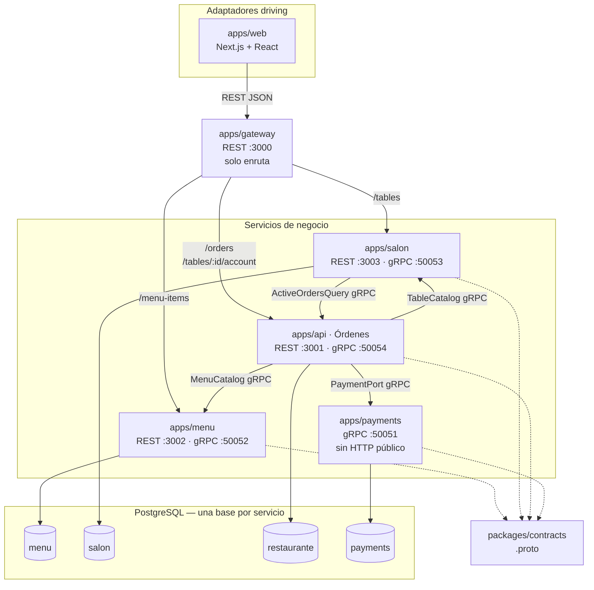

## 2.2 Qué hace cada pieza

| Contenedor | Función | No hace |
|------------|---------|---------|
| **Web** | Pantallas → gateway | Totales, cocina, cobro |
| **Gateway** | Enruta por path; CORS | Lógica de negocio |
| **Menú** | CRUD + snapshot gRPC | Órdenes / cobros |
| **Salón** | CRUD mesas + snapshot; consulta comanda activa al dar de baja | Ocupación persistida |
| **Órdenes** | Comanda, cocina, totales, cuenta, cierre | Catálogo vivo ni detalle del medio |
| **Pagos** | Charge / Void / GetReceipt (idempotente por `subjectId`) | REST al navegador |

### Enrutado del gateway

| Path | Upstream |
|------|----------|
| `/menu-items…` | Menú |
| `/tables/:tableId/account…` | Órdenes |
| `/tables…` | Salón |
| `/orders…` | Órdenes |
| otro | 404 |

## 2.3 Hexágono dentro de cada servicio

```text
  REST / gRPC (driving)          gRPC clientes / Drizzle (driven)
           │                              ▲
           ▼                              │
     Controllers / servers          Adapters
           │                              │
           ▼                              │
     Casos de uso  ── puertos ────────────┘
           │
           ▼
        Dominio
```

Dependencias: `adapters → application → domain`. El módulo Nest es el composition root.

## 2.4 Comunicación

| Tramo | Protocolo |
|-------|-----------|
| Navegador → gateway → Menú/Salón/Órdenes | REST + JSON + Zod |
| Órdenes → Menú | gRPC `GetMenuItem` |
| Órdenes → Salón | gRPC `GetTable` |
| Salón → Órdenes | gRPC `HasActiveOrder` |
| Órdenes → Pagos | gRPC `Charge` / `Void` / `GetReceipt` |
| Outbox cocina | `OrderSentToKitchen` (aviso asíncrono) |

## 2.5 Funcionamiento del recorrido demo (mesa)

1. Web pide platos y mesas al gateway.  
2. Abrir comanda: Órdenes valida mesa por gRPC a Salón.  
3. Agregar línea: snapshot de Menú; se **congela** precio/impuesto/mods (sin FK).  
4. Cocina muta el agregado (`OPEN → … → READY`); outbox al enviar.  
5. Totales en dominio de Órdenes.  
6. Cierre: Charge en Pagos; si falla persistir CLOSED → Void.

Si Menú cae: se cocina/cobra lo capturado. Si Pagos cae: se cocina, no se cierra. Si Órdenes cae: el piso se detiene; admin menú/mesas sigue.

## 2.6 Layout y despliegue

```text
apps/web, gateway, menu, salon, api (Órdenes), payments
packages/contracts
```

| Proceso PM2 | Puerto |
|-------------|--------|
| `restaurante-gateway` | HTTP 3000 |
| `restaurante-api` | HTTP 3001, gRPC 50054 |
| `restaurante-menu` | HTTP 3002, gRPC 50052 |
| `restaurante-salon` | HTTP 3003, gRPC 50053 |
| `restaurante-payments` | gRPC 50051 |
| `restaurante-web` | `https://restaurante.localhost` |

---

# 3. Casos de uso

**Actores:** admin, mesero, cocina, caja.

## 3.1 Vista general RF1–RF5

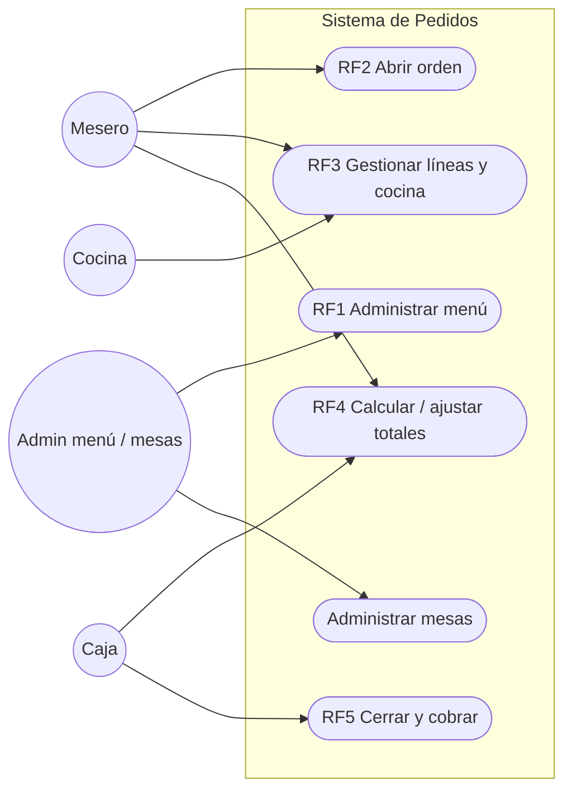

## 3.2 Menú (RF1)

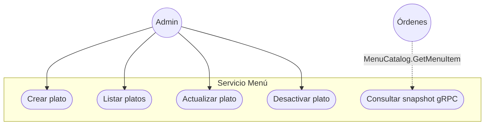

## 3.3 Salón

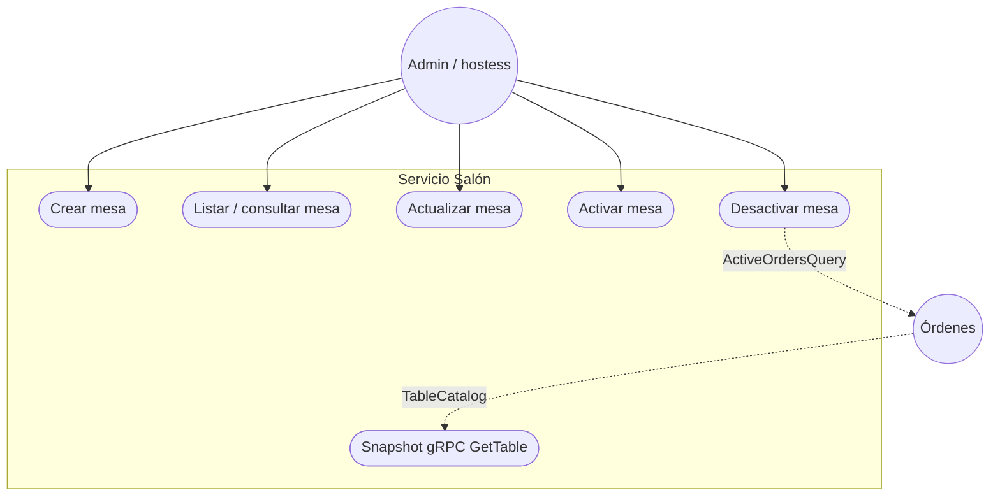

Invariante: no dar de baja mesa si hay comanda activa.

## 3.4 Órdenes y cocina (RF2–RF4)

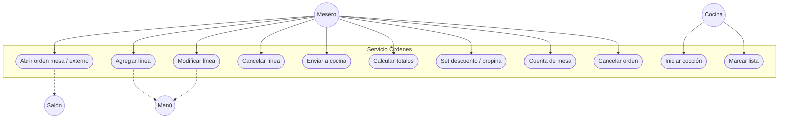

| Estado | Editar líneas | Cancelar orden |
|--------|---------------|----------------|
| `OPEN` | Sí | Sí |
| `SENT_TO_KITCHEN` | No | Sí |
| `IN_KITCHEN` | No | No |
| `READY` | No | No (sigue a cobro) |
| `CLOSED` / `CANCELLED` | No | — |

## 3.5 Pagos (RF5)

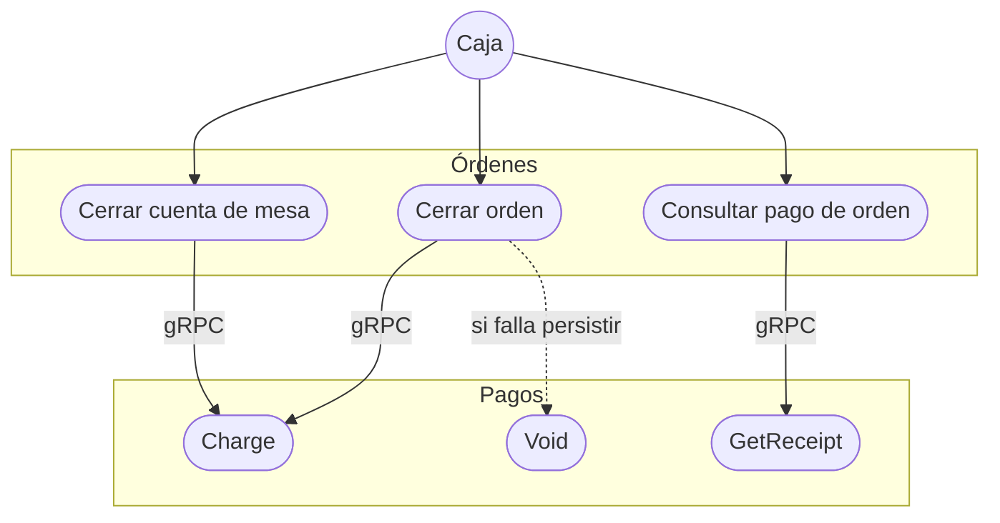

Medios MVP: `cash`, `card`, `digitalGateway` (simulados).

## 3.6 Caso → endpoint → servicio

| Caso | Path (vía gateway) | Servicio |
|------|--------------------|----------|
| CRUD menú | `/menu-items…` | Menú |
| CRUD mesas | `/tables…` | Salón |
| Órdenes / líneas / cocina | `/orders…` | Órdenes |
| Totales | `…/totals`, `…/discount`, `…/tip` | Órdenes |
| Cobro | `…/close`, `…/payment` | Órdenes → Pagos |
| Cuenta mesa | `/tables/:id/account…` | Órdenes |

---

# 4. Flujos de negocio

## 4.1 Comanda de mesa

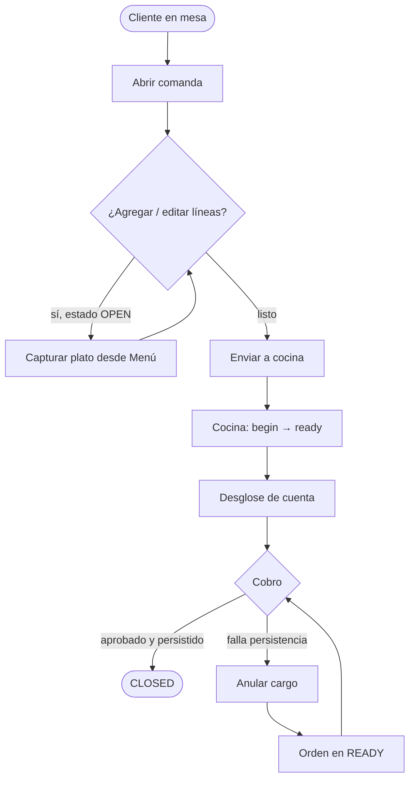

```text
OPEN → SENT_TO_KITCHEN → IN_KITCHEN → READY → CLOSED
 │            │
 └────────────┴──→ CANCELLED
```

## 4.2 Pedido externo

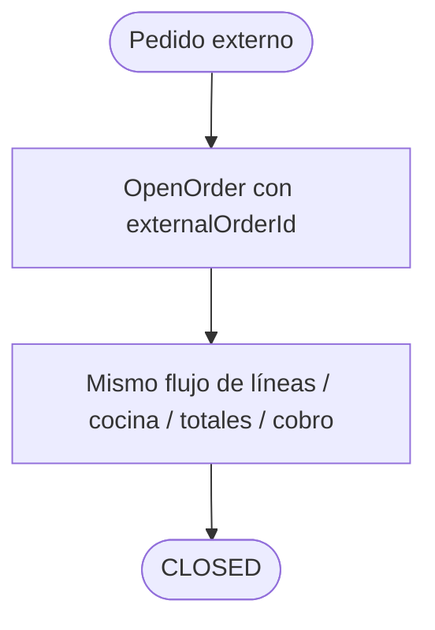

Sin consulta a Salón.

## 4.3 Admin menú y baja de mesa

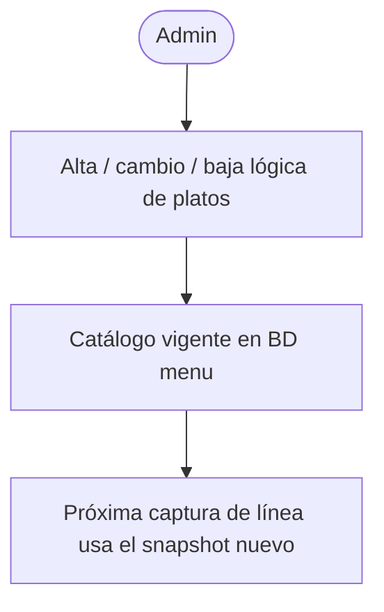

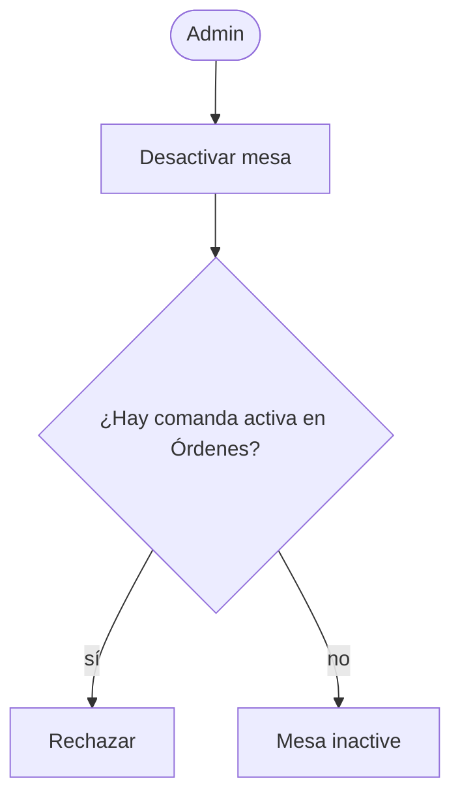

## 4.4 Independencia ante fallos

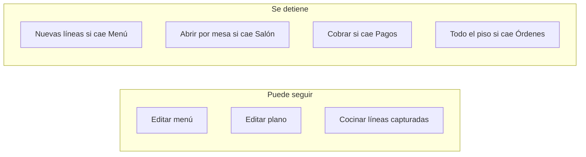

---

# 5. Diagramas de secuencia

## 5.1 Abrir orden de mesa (RF2)

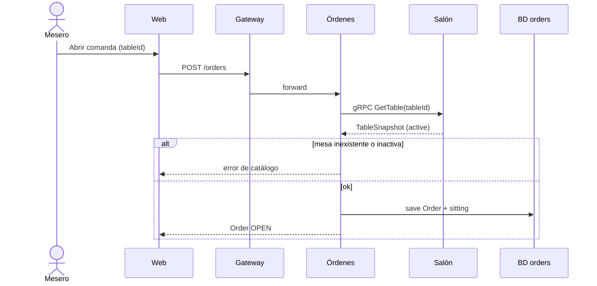

Externo: igual **sin** Salón (`externalOrderId`).

## 5.2 Agregar línea (RF3)

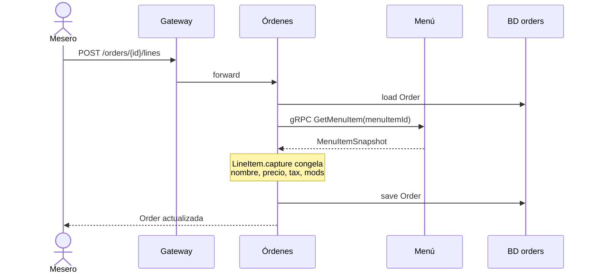

## 5.3 Ciclo de cocina (RF3)

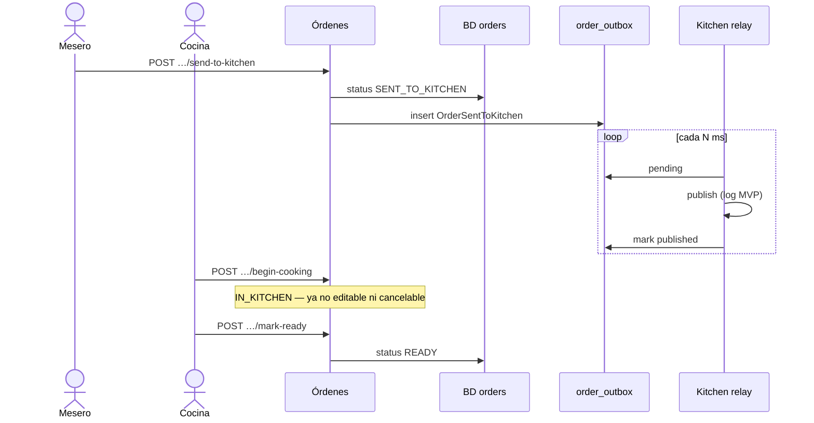

## 5.4 Totales (RF4)

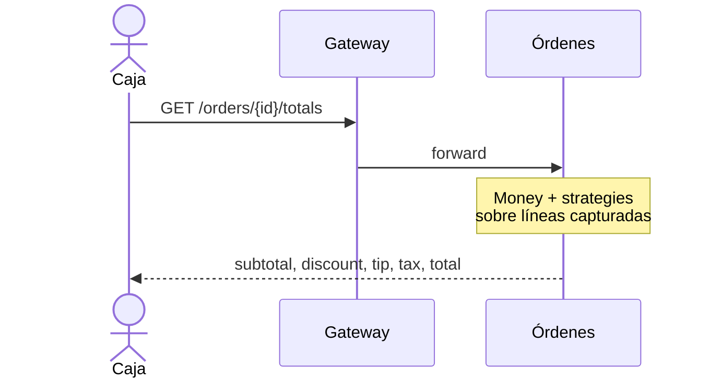

## 5.5 Cerrar y cobrar — saga (RF5)

```mermaid
sequenceDiagram
  actor Caja
  participant GW as Gateway
  participant Ord as Órdenes
  participant Pay as Pagos
  participant DBo as BD orders
  participant DBp as BD payments

  Caja->>GW: POST /orders/{id}/close
  GW->>Ord: forward
  Ord->>DBo: load Order READY
  Ord->>Ord: totals() == expectedTotal
  Ord->>Pay: gRPC Charge(subjectId=orderId)
  Pay->>DBp: insert approved (idempotente)
  Pay-->>Ord: receipt
  alt persistir CLOSED ok
    Ord->>DBo: CLOSED + paymentId/reference
    Ord-->>Caja: orden cerrada
  else falla el guardado
    Ord->>Pay: gRPC Void(reference)
    alt void ok
      Pay->>DBp: status voided
      Ord-->>Caja: error; orden sigue READY
    else void falla
      Ord-->>Caja: PaymentVoidFailed; conciliar
    end
  end
```

`CloseTableAccount` igual con `subjectId = sittingId`.

## 5.6 Desactivar mesa

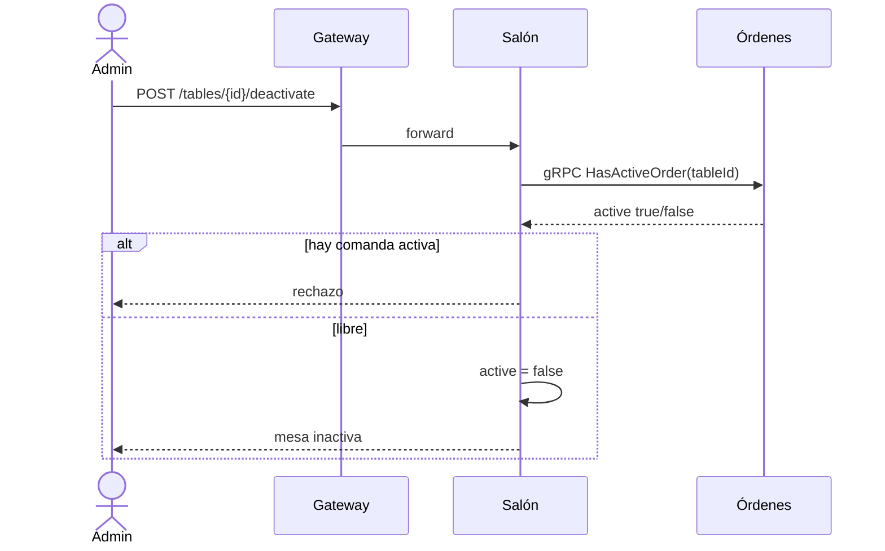

## 5.7 Admin de menú

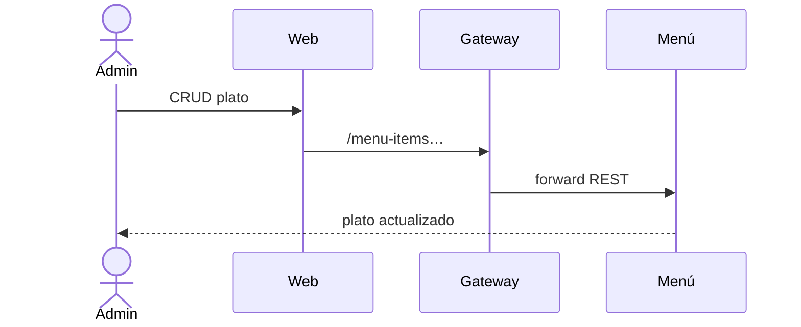

---

# 6. Modelo entidad–relación

Cada servicio tiene **su propia base**. Sin FK entre bases: solo ids lógicos o snapshots.

## 6.1 Vista lógica entre contextos

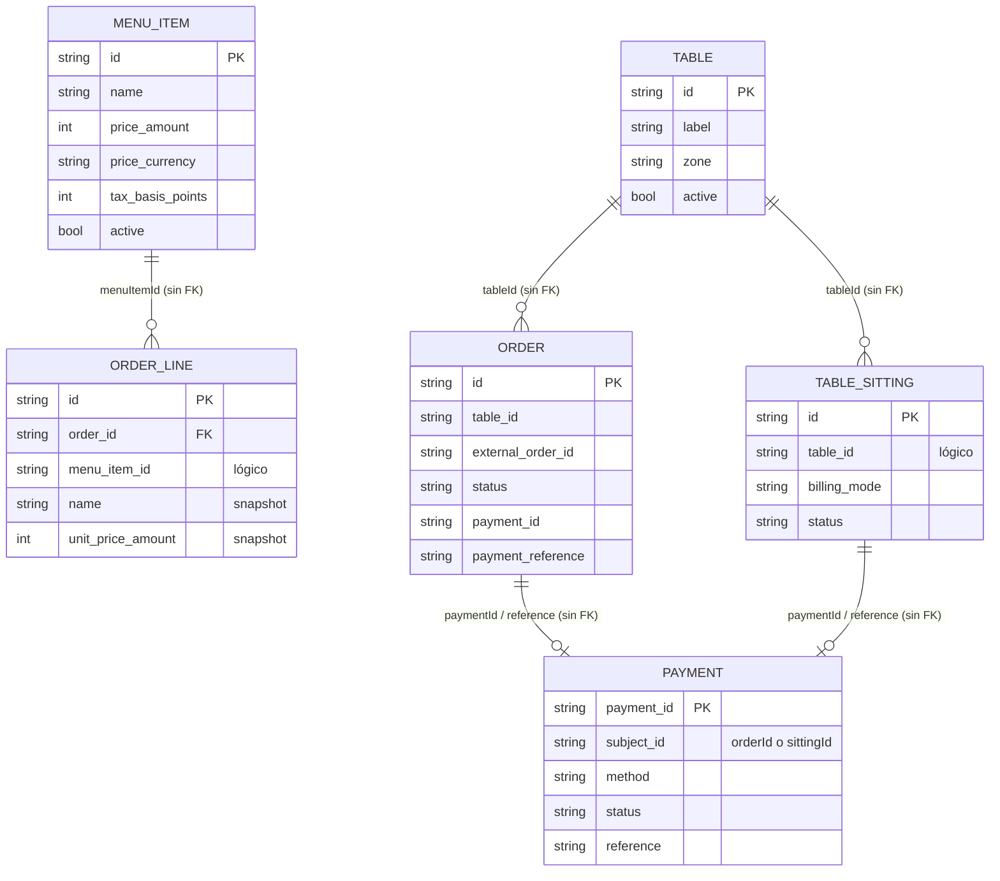

## 6.2 Base `menu`

```mermaid
erDiagram
  menu_items ||--o{ menu_item_ingredients : tiene
  menu_items ||--o{ menu_item_modifiers : tiene
  menu_item_ingredients ||--o{ menu_item_modifiers : "exclusión nombra ingrediente"

  menu_items {
    text id PK
    text name
    int price_amount
    text price_currency
    int tax_basis_points
    bool active
  }
  menu_item_ingredients {
    text id PK
    text menu_item_id FK
    text name
    int position
  }
  menu_item_modifiers {
    text id PK
    text menu_item_id FK
    text name
    text kind "extra|exclusion"
    text ingredient_id FK_opcional
    int price_amount
    text price_currency
    int position
  }
```

## 6.3 Base `salon`

```mermaid
erDiagram
  tables {
    text id PK
    text label
    text zone
    bool active
  }
```

Ocupación: no es columna; se pregunta a Órdenes.

## 6.4 Base Órdenes (`restaurante`)

```mermaid
erDiagram
  orders ||--o{ order_lines : contiene
  order_lines ||--o{ order_line_modifiers : lleva
  orders }o--o| table_sittings : sitting_id
  orders ||--o{ order_outbox : eventos

  orders {
    text id PK
    text table_id
    text external_order_id
    text status
    timestamptz opened_at
    int version
    text discount_kind
    text tip_kind
    text sitting_id
    text payment_id
    text payment_reference
  }
  order_lines {
    text id PK
    text order_id FK
    text menu_item_id
    text name
    int unit_price_amount
    text unit_price_currency
    int tax_basis_points
    int quantity
    int position
  }
  order_line_modifiers {
    text order_line_id PK_FK
    int position PK
    text modifier_id
    text name
    text kind
    int price_amount
    text price_currency
  }
  table_sittings {
    text id PK
    text table_id
    text status "OPEN|CLOSED"
    text billing_mode "combined|separate"
    text payment_id
    text payment_reference
  }
  order_outbox {
    text id PK
    text event_type "OrderSentToKitchen"
    text order_id
    text status
    timestamptz occurred_at
    timestamptz published_at
  }
```

Origen: exactamente uno de `table_id` o `external_order_id`. `menu_item_id` sin FK a Menú.

## 6.5 Base `payments`

```mermaid
erDiagram
  payments {
    text payment_id PK
    text subject_id
    text method "cash|card|digitalGateway"
    int amount
    text currency
    int tendered_amount
    text card_last4
    text payer_reference
    text reference UK
    timestamptz paid_at
    text status "approved|voided"
  }
```

Un solo `approved` por `subject_id`. Void libera la clave.

## 6.6 Consistencia entre servicios

| Dato | Dueño | Uso ajeno |
|------|-------|-----------|
| Precio / impuesto | Menú | Snapshot en `order_lines` |
| Mesa activa | Salón | Validación gRPC; id texto |
| Cocina y totales | Órdenes | Nadie más escribe el agregado |
| Detalle del medio | Pagos | Órdenes guarda `paymentId` + `reference` |

---

# 7. Navegación UI

La web **no** calcula totales ni cocina. Llama al gateway (`NEXT_PUBLIC_API_URL` → `:3000`).

## 7.1 Mapa de rutas

```mermaid
flowchart TB
  Home["/  Home = plano de mesas"]
  Menu["/menu  Admin menú"]
  Mesas["/mesas  Plano"]
  MesasAdmin["/mesas/admin  Alta/baja mesas"]
  Ordenes["/ordenes  Listado / comanda"]
  Orden["/ordenes/[orderId]"]
  Cuenta["/ordenes/[orderId]/cuenta"]
  Cobro["/ordenes/[orderId]/cobro"]
  Cocina["/cocina  Cola de cocina"]
  Pago["/pago…  Atajos de cobro / mesa"]
  Ingreso["/ingreso  Entrada de sesión demo"]

  Home --> Mesas
  Home --> Menu
  Home --> Ordenes
  Home --> Cocina
  Home --> Pago
  Home --> Ingreso
  Mesas --> MesasAdmin
  Mesas --> Ordenes
  Ordenes --> Orden
  Orden --> Cuenta
  Orden --> Cobro
  Cuenta --> Cobro
  Cocina --> Orden
  Pago --> Cobro
```

## 7.2 Recorrido demo mesa

```mermaid
flowchart LR
  A[Plano /mesas] --> B[Abrir orden]
  B --> C[Comanda /ordenes/id]
  C --> D[Agregar líneas]
  D --> E[Enviar a cocina]
  E --> F[/cocina]
  F --> G[begin-cooking / mark-ready]
  G --> H[/cuenta]
  H --> I[/cobro]
  I --> J[Orden CLOSED]
```

| Paso UI | API (gateway) | Servicio |
|---------|---------------|----------|
| Plano | `GET /tables` | Salón |
| Abrir | `POST /orders` | Órdenes (+ Salón) |
| Líneas | `POST …/lines` | Órdenes (+ Menú) |
| Cocina | `…/send-to-kitchen` etc. | Órdenes |
| Cuenta | `GET …/totals` | Órdenes |
| Cobro | `POST …/close` | Órdenes → Pagos |

Admin menú: `/menu` → `/menu-items`. Externo: mismo flujo con `externalOrderId`.

Criterio UI: total = el de la API; tras cambios visibles, `pnpm dev:restart`.

---

# 8. Guía de extensión

## 8.1 Principios

1. Un servicio = un dueño de datos (una base). Sin FK entre bases.  
2. Entre servicios: puertos de dominio; gRPC detrás del puerto.  
3. Contratos en `packages/contracts`. No compartir entidad `Order` entre apps.  
4. Gateway solo enruta.  
5. Composition root elige el adaptador.  
6. Orden: dominio + tests → puerto + fake → adaptador → HTTP/gRPC → cableado.

## 8.2 Nuevo medio de cobro

Strategy en Pagos + (si hace falta) campo en proto + registrar `GrpcPaymentAdapter` en `PAYMENT_PORTS` + opción en UI. No hace falta un quinto servicio.

## 8.3 Nuevo canal de entrada

Otro adaptador driving contra el gateway (mismas rutas). Con `externalOrderId` reutiliza `OpenOrder` sin Salón.

## 8.4 Extraer un servicio nuevo

| Paso | Evidencia |
|------|-----------|
| A. Contexto | Dueño + tablas |
| B. Sin FK cruzada | Ids / snapshots |
| C. Puerto | Lenguaje de dominio |
| D. Proto | `packages/contracts` |
| E. App Nest | Hexágono + su BD |
| F. Gateway | Prefijo REST solo si es público |
| G. PM2 | Proceso + puertos |
| H. Fallos | Qué sigue / qué para |

**No extraer** cocina ni cálculo de totales (invariantes del agregado `Order`).

## 8.5 Plantilla de puerto

```typescript
export interface MenuCatalog {
  findById(id: string): Promise<MenuItemSnapshot | null>;
}

class GrpcMenuCatalog implements MenuCatalog { /* GetMenuItem */ }

{ provide: MENU_CATALOG, useValue: new GrpcMenuCatalog(caller) }
```

## 8.6 Eventos

Outbox `OrderSentToKitchen` = aviso. No sustituye Charge ni GetMenuItem. Eventos solo si no se necesita respuesta síncrona y se tolera consistencia eventual.

## 8.7 Modelo mental

```text
RF  →  caso de uso  →  servicio dueño
                 ↘ puerto  →  otro servicio / BD / cobro
UI / Gateway  →  solo disparan casos
```

---

# 9. Verificación

Corrida 4 nov 2026 vía gateway:

1. `POST /menu-items` (Menú)  
2. `POST /tables` (Salón)  
3. Abrir orden de mesa → línea (Órdenes + gRPC Menú + gRPC Salón)  
4. `send-to-kitchen` → `begin-cooking` → `mark-ready`  
5. Totales + `POST …/close` efectivo (Órdenes + gRPC Pagos) → `CLOSED`

**Resultado: SMOKE_OK.**

También en verde: tests del gateway (enrutado) y casos `OpenOrder` / outbox de cocina.

Comandos demo: `pnpm dev` / `dev:restart` / `dev:stop` / `dev:status`.

---

# Conclusión

Se entrega RF1–RF5 como microservicios con hexágono por servicio, gateway REST, bases separadas y cobro por gRPC. Este documento concentra propuesta, arquitectura, casos de uso, flujos, secuencias, E-R, navegación y cómo extender el sistema.
